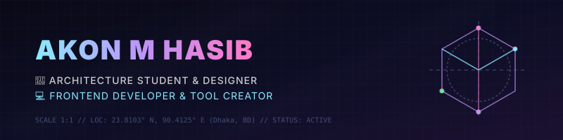

  

 

  
  
  

# 📐 About Me

I am an **Architecture Student, Designer, and Frontend Developer** based in Dhaka, Bangladesh. I believe that design is not just about spaces, but also about how we interact with technology. My work bridges the gap between physical architecture and digital engineering, combining spatial design aesthetics with modern web technologies.

* 🎓 Pursuing a degree in **Architecture**, exploring building designs, spatial planning, and visual representation.
* 💻 Graduated with a **Diploma in Engineering** (2022) from Barisal Polytechnic Institute.
* 🛠️ Active frontend developer and open-source contributor with over 5 years of coding experience.
* 🎨 Creator of developer utility tools and custom themes (including VS Code themes with thousands of installs).
* 📚 Passionate about education, sharing knowledge on web development, freelancing, and design.

---

# 🛠️ Tech Stack & Creative Toolkit

<table width="100%">
  <tr>
    <td width="50%" valign="top">
      <h4>💻 Software &amp; Frontend Development</h4>
      
      
      
      
      
       
      
      
      
      
      
    </td>
    <td width="50%" valign="top">
      <h4>📐 Architecture, UI/UX &amp; Design</h4>
      
      
      
      
      
    </td>
  </tr>
</table>

---

# 🚀 Featured Developer Extensions & Tools

Here are some of the popular open-source projects, libraries, and VS Code extensions that I've developed:

<table>
  <tr>
    <td width="50%" valign="top">
      <h3>🎨 <a href="https://github.com/AkonMHasib/Sizdah-Theme-Collection">Sizdah Theme Collection</a></h3>
      
A sleek, premium, dark theme collection built for Visual Studio Code designed to provide maximum readability, contrast, and visual delight for long coding sessions.

      <code>VS Code Extension</code> <code>Dracula Theme Styles</code>
    </td>
    <td width="50%" valign="top">
      <h3>🧠 <a href="https://github.com/AkonMHasib/Stateyze">Stateyze</a></h3>
      
A lightweight, performant, and simple state management library for React applications. Say goodbye to boilerplate code and manage application states with ease.

      <code>TypeScript</code> <code>React</code> <code>Library</code>
    </td>
  </tr>
  <tr>
    <td width="50%" valign="top">
      <h3>🔍 <a href="https://github.com/AkonMHasib/Regex-Builder-VSCode">Regex Builder</a></h3>
      
A Visual Studio Code extension to easily build, test, and visualize regular expressions directly inside your IDE without context-switching to browser tools.

      <code>TypeScript</code> <code>VS Code Extension</code>
    </td>
    <td width="50%" valign="top">
      <h3>📊 <a href="https://github.com/AkonMHasib/Project-Dashboard-VSCode">Project Dashboard</a></h3>
      
Organize, bookmark, and quickly jump between your workspaces and folders in Visual Studio Code with a clean, grid-based graphical dashboard.

      <code>TypeScript</code> <code>VS Code Extension</code> <code>UX</code>
    </td>
  </tr>
</table>

---

# 📊 GitHub Stats & Streaks

  <table border="0">
    <tr>
      <td width="50%">
        
      </td>
      <td width="50%">
        
      </td>
    </tr>
    <tr>
      <td colspan="2" align="center">
        
      </td>
    </tr>
  </table>

---

# 🤝 Let's Connect!

If you want to collaborate on a design, web project, discuss architectural ideas, or just say hello:

* 🌐 **Portfolio Website**: [akonmhasib.site](https://www.akonmhasib.site/)
* 💼 **LinkedIn**: [in/AkonMHasib](https://www.linkedin.com/in/AkonMHasib)
* 📺 **YouTube**: [@AkonTeaches](https://www.youtube.com/@AkonTeaches)
* 📬 **Email**: [hasiburbd24@gmail.com](mailto:hasiburbd24@gmail.com)
* 📘 **Facebook**: [AkonMHasib](https://www.facebook.com/AkonMHasib)

  Designed with ❤️ by Akon M Hasib

